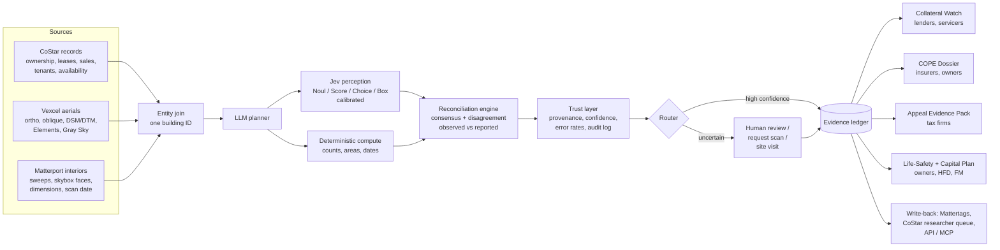

# Sell Verified Building Evidence, Lenders First

## 1. The answer: a verified building evidence ledger, sold first to Houston lenders and servicers

**The service.** Build a **verified building evidence ledger**: one record per building in which every important fact (occupancy, area, stories, condition, roof, ground-floor equipment, parking use, tenant use) has three independent witnesses. CoStar records say what people *reported* (leases, sales, tenants, availability). Matterport interiors show what the inside *looked like on scan day*. Vexcel aerials show what the outside *looked like on each flight date*. For each field the ledger stores the value from each witness, the capture date, a consensus value, a calibrated confidence, a viewable evidence link and a "send a human" flag. Vertical products are views and workflows over that one ledger. **Why:** every incumbent sees only one or two of these witnesses. Record vendors (CoStar, Crexi, Reonomy, Trepp) stop at what was reported. Aerial vendors (Nearmap, EagleView, Moody's/CAPE, ZestyAI) stop at the roofline. AI startups that raised money in 2026 (Cadastral $9.5M, CarbonAI $12M) read documents, not buildings ([Mann Report](https://www.mannpublications.com/mannreport/2026/02/05/cadastral-raises-9-5m/); [The Next Web](https://thenextweb.com/news/carbonai-12m-cre-lending-agents)). CoStar Group is the only company that will own all three layers once its **~$730M Vexcel purchase** closes in Q1 2027, after its **$1.6B Matterport** deal closed in February 2025 ([CoStar 8-K Ex. 99.2](https://www.sec.gov/Archives/edgar/data/0001057352/000105735226000078/exhibit992-vexcelpressre.htm); [Matterport blog](https://matterport.com/blog/matterports-next-chapter-as-part-of-costar-group)).

**The first vertical: CRE lenders and CMBS special servicers, starting with Houston office collateral.** The first product is a "Collateral Watch": a quarterly occupancy and condition check per loan, plus a desk-level "pre-PCA screen" before a renewal, modification or workout. **Why lenders first:**

- **The pain is acute and measurable.** Trepp's CMBS delinquency rate hit **8.02% in September 2026**, the highest since November 2020, and office reached **12.16%** ([CRE Daily](https://www.credaily.com/?p=224934)). About **$875B** of commercial and multifamily mortgages mature in 2026 ([MBA](https://www.mba.org/news-and-research/newsroom/news/2026/02/09/17-percent-of-commercial-and-multifamily-mortgage-balances-to-mature-in-2026)). Houston office vacancy sits at **23.9–25.6%** ([CBRE](https://www.cbre.com/insights/figures/houston-office-figures-q3-2026); [CRE Daily](https://www.credaily.com/?p=224274)).
- **The existing alternative is slow and costly.** Physical evidence comes from property condition assessments (PCAs) at **$2,500–$8,000 and 10–15 business days** each ([US Building Inspections](https://usbuildinginspections.com/property-condition-assessment-report-lender-requirements/)).
- **The signal is unique.** "Leased but dark" space, where the lease file says occupied and the floors and parking lot say empty, is visible only when records and imagery are compared.
- **It rides CoStar's own lender roadmap.** That roadmap is the Debt Solutions Benchmark on **$1.5T of debt across 155,000+ loans**, with loan origination planned for 2027 ([CoStar Q3 2026 call](https://www.fool.com/earnings/call-transcripts/2026/10/28/costar-csgp-q3-2026-earnings-call-transcript/)).

**Who it helps:** lenders and servicers, which get triage before they spend on site visits; CoStar, which gets a new lender module and proof that its proprietary data beats public-data AI; Matterport, which gets an operational use case beyond listing marketing; and Vexcel, which gets a commercial-real-estate outlet beyond insurance.

**The vertical order.** First, lenders and servicers. Second, commercial property and casualty (P&C) insurance, the largest budget but entrenched. Its entry point is the attributes aerial vendors cannot see: occupancy and fire protection. Third, Houston property-tax appeal firms, which buy evidence on a fixed annual cycle under contingency fees. Fourth, an owner/operator bundle combining a high-rise fire safety plan and a capital plan, so one scan serves several budgets.

**The binding constraint is licensing, not technology.** CoStar's October 2026 terms reportedly bar licensees from sharing data with third-party AI services. Matterport's terms bar AI training. Vexcel's EULA bars competing analytics offerings ([MarketIntelligenceTools](https://marketintelligencetools.com/reports/costar-pricing/); [Matterport Terms](https://matterport.com/terms-of-use); [Vexcel EULA](https://vexceldata.com/eula/)). The service is therefore commercially viable only as a **CoStar-operated product** (or a CoStar-licensed partner). That makes it a product CoStar ships, not a company that resells CoStar data.

| Question | Answer | Why (evidence) | Who it helps |
|---|---|---|---|
| What is sold? | Per-building, per-field verified evidence with provenance and calibrated confidence, delivered as vertical products | Incumbents each see one or two witnesses. Regulators want dated, explainable evidence ([Delaware DOI](https://news.delaware.gov/?p=223661)) | Every buyer; CoStar's "verified data beats public-data AI" claim |
| First vertical? | Lenders and special servicers (Houston office) | 8%+ CMBS delinquency; $2.5–8K, 2–3 week PCAs; CoStar's lender roadmap | Lenders, servicers; CoStar Debt Solutions |
| Second? | Commercial P&C insurance (COPE/ITV dossier) | Largest existing data budget; aerial vendors can't see occupancy or protection | Insurers, owners; Vexcel's insurance book |
| Third? | Property-tax appeal firms (Texas annual cycle) | 50% contingency fees; interior evidence wins appeals ([O'Connor terms](https://www.poconnor.com/wp-content/uploads/2023/06/Our-Terms.pdf)) | Appeal firms, owners |
| Fourth? | Owner bundle: fire safety plan plus capital plan | Houston high-rise owners must produce fire safety plans ([HFD LSB Std 07](https://www.houstonpermittingcenter.org/media/9111/download)) | Owners, property managers, HFD; Matterport enterprise |
| How sold? | Through CoStar's ~2,000 salespeople and Vexcel's insurer relationships, with Matterport enterprise for owners | Vexcel had a six-person sales team at the deal ([Bisnow](https://www.bisnow.com/news/national/technology/costar-to-acquire-aerial-imagery-company-for-730m)) | CoStar, Vexcel |
| Biggest risk? | Data licensing and Matterport commercial interior coverage | CoStar, Matterport and Vexcel terms; scans skew to marketed vacant space | All three companies |

## 2. First principles

*(Written separately; not repeated here.)*

## 3. Who makes decisions about buildings: lenders and insurers spend most, most often

The buyer map below ranks buyers by how often they make a costly decision about one specific building and what they already pay to make it. The pattern is clear. **Lenders, servicers and insurers make recurring, high-stakes building decisions and already buy third-party evidence.** Tax-appeal firms decide once a year but get paid as a share of the savings. Brokers, appraisers and fire departments need the data but have the least ability to pay.

| Buyer | Decision about a building | Frequency | Current spend and tools | Value of verified evidence |
|---|---|---|---|---|
| **Bank CRE lender / credit officer** | Originate, renew, extend; set reserves; report concentrations | Per deal; annual review; quarterly for watchlist loans | CoStar for Lenders and Risk Analytics (COMPASS default model) ([CoStar Risk Analytics](https://costar.com/ja-jp/node/1586)); appraisal; PCA **$2.5–8K**; Phase I ESA **$2–6.5K**, 3–4 weeks ([Fehr Graham](https://www.fehrgraham.com/about-us/blog/phase-i-environmental-site-assessment-cost-fg)) | Evidence between inspections; examiner-ready breakdowns by submarket and property type ([OCC Bulletin 2026-49](https://occ.gov/news-issuances/bulletins/2026/bulletin-2026-49.html)) |
| **CMBS master / special servicer** | Watchlist, modify, foreclose, dispose of REO | Monthly surveillance; annual inspections (frequency unsourced) | Trepp loan data; inspection firms; appraisals and broker opinions of value (BOVs); CarbonAI-type document agents ([The Next Web](https://thenextweb.com/news/carbonai-12m-cre-lending-agents)) | Triage which of hundreds of loans need a site visit; spot leased-but-dark collateral |
| **Acquisitions / investor** | Bid or pass, price, capex reserve | Per deal | Five third-party reports ordered in parallel (appraisal, PCA, ESA, zoning, survey) ([APERS](https://apers.app/learn/transaction-lifecycle/due-diligence/third-party-reports-appraisal-pca-esa-zoning)); Cadastral, Dealpath | Physical screen before the letter of intent; scope the PCA |
| **Asset manager / owner** | Capex, leasing, insurance renewal, tax protest | Annual cycles | PCA/FCA vendors, insurance brokers, tax consultants | One dossier reused across insurance, tax and capital planning |
| **Commercial P&C underwriter** | Bind, price, renew; insurance-to-value (ITV) | Per policy, annually | Moody's/CAPE, ZestyAI, Nearmap/Betterview, EagleView, Verisk; loss-control inspections, most of which produce **no underwriting action** ([Verisk](https://www.verisk.com/blog/dynamic-duo-pairing-skilled-survey-professionals-with-virtual-technology-is-transforming-commercial-property-inspections/)) | Occupancy and Protection (the "O" and "P" of COPE), which aerials cannot see |
| **Claims adjuster** | Is this damage new or pre-existing? | Per event (hail, hurricane) | Vexcel Gray Sky, Nearmap catastrophe imagery, Xactimate with Matterport TruePlan ([Verisk](https://www.verisk.com/company/newsroom/new-verisk-and-matterport-integration-accelerates-sketching-process-for-insurance-claims/)) | A pre-loss interior and exterior baseline |
| **Property-tax consultant** | Protest or not; what evidence to bring | Annual (HCAD protest deadline May 15) ([HCAD](https://hcad.org/assets/uploads/pdf/26-08-Protest-Deadline-Reminder.pdf)) | Contingency fee **up to 50% of savings**; the firm pays for experts in judicial appeals ([O'Connor](https://www.poconnor.com/wp-content/uploads/2023/06/Our-Terms.pdf)) | Interior condition, functional obsolescence and measured area, none of which is visible from the air |
| **Appraisal district (HCAD)** | Mass appraisal | Annual | EagleView obliques at a reported **$750–800K/yr**; Cyclomedia street-level imagery ([O'Connor 2024](https://www.poconnor.com/Harris-county-texas-property-tax-2024); [H-GAC](https://h-gac.com/getmedia/b9c3e59d-4ac0-4808-a971-f4459153c75a/HCAD_Cyclomedia_aStepTowardMakingDigitalTwin_HGAC_compressed)) | A "digital twin" of the tax roll, but procurement is slow RFP or sole-source |
| **Leasing / investment broker** | Pitch, list, tour | Continuous | CoStar seat **~$500–560/month**; Crexi Intelligence ~$2,388/yr; Reonomy ~$4,800/yr ([MarketIntelligenceTools](https://marketintelligencetools.com/reports/costar-pricing/); [TrustRadius](https://www.trustradius.com/products/crexi/pricing)) | Pitch material; low willingness to pay and resentful of seats |
| **Appraiser / AMC / lender review desk** | Describe and value the subject property | Per assignment | Fees up ~5%/yr (2024) ([LightBox](https://lbrestaging.wpengine.com/insight/top-5-trends-impacting-cre-appraisers/)); certified general appraiser count **+0.1%** over 2020–2025 ([Prosight FA](https://www.prosightfa.org/?p=13820)) | Verified area and condition; individual appraisers pay little, the review desk is the buyer |
| **Fire department / high-rise owner** | Pre-incident plan; high-rise fire safety plan | One-time plus updates | FlowMSP **$800/yr** (small city); First Due **$354K over 3 years** (Fresno) ([Fairbury News](https://fairburynews.net/post/planning-proposal-approved); [Fresno](https://agendas.fresno.gov/pa/legislation/id-24-1572-18859)) | A pre-plan assembled from the interior scan, aerial access and tenant hazards |
| **Institutional facilities / capital planning** | Capital renewal priorities | Annual | Facility condition assessments (FCAs); deferred renewal backlog **$156/GSF** in higher education ([Spaces4Learning](https://spaces4learning.com/articles/2026/04/09/gordian-state-of-facilities-report.aspx?p=1)) | An FCA-lite plus as-built drawings priced well below a full FCA |
| **Accessibility inspector (Texas RAS)** | Texas Architectural Barriers Act (TABA) plan review and inspection | Per project ≥$50K | **24,856** project registrations handled by **594** Registered Accessibility Specialists in FY25 ([TDLR](https://www.tdlr.texas.gov/media/pdf/EAB%20at%20a%20Glance.pdf)) | A pre-screen that raises inspector throughput |

**What the map implies.** The best first buyer has three things at once: a decision it repeats on many buildings, an existing line item for physical evidence, and a relationship with CoStar already in place. Only lenders and servicers have all three. Insurers have the first two and a Vexcel relationship but not a CoStar one. Tax firms have a strong per-building incentive but a narrower market. **Who it helps:** the map tells CoStar's sales organization where the money already flows, and it keeps the team from aiming a demo at buyers (brokers, appraisers, fire departments) who love the idea but cannot fund it.

## 4. Pain points by vertical: every buyer pays for slow, stale, one-sided evidence

Across verticals the same three pains recur. The evidence is **slow** (weeks for a report), **stale** (an annual inspection, a scan from last year, a flight from last spring), and **one-sided** (records without eyes, or eyes without records). The numbers differ by buyer.

### Lenders and servicers: distress is rising faster than inspection capacity

The maturity wall is past its dollar peak, but distress is not. MBA counts **$875B** maturing in 2026, including **$167B of office**, with another **$123B of office in 2027** ([MBA](https://www.mba.org/news-and-research/newsroom/news/2026/02/09/17-percent-of-commercial-and-multifamily-mortgage-balances-to-mature-in-2026); [Briefs.co](https://www.briefs.co/news/commercial-property-loan-maturities-hit-875-billion-in-2026/)). Trepp's CMBS delinquency rate reached **8.02% in September 2026** and was 7.87% in October, while retail jumped 63 bps ([CRE Daily](https://www.credaily.com/?p=224934)). MSCI put distressed US CRE at **$130.3B** at end-2025 ([CRE Daily](https://newsletter.credaily.com/p/cre-debt-wave-eases-as-new-loan-activity-rebounds)).

Regulators are adding scrutiny. The OCC issued version 3.0 of its Concentrations of Credit handbook as Bulletin 2026-49, and its Spring 2026 risk report flagged more office charge-offs at large banks ([OCC Bulletin 2026-49](https://occ.gov/news-issuances/bulletins/2026/bulletin-2026-49.html); [OCC SRP Spring 2026](https://www.occ.treas.gov/publications-and-resources/publications/semiannual-risk-perspective/files/pub-semiannual-risk-perspective-spring-2026.pdf)). The Fed is giving extra scrutiny to regional banks with office and multifamily exposure ([CRE Daily](https://www.credaily.com/briefs/cre-lending-under-fed-scrutiny-amid-office-and-multifamily-risks/)).

Meanwhile the physical evidence still comes from PCAs (**$2,500–$8,000, 10–15 business days**) and Phase I ESAs (**$2,000–$6,500, 3–4 weeks**). Those price ranges are vendor marketing and directional ([US Building Inspections](https://usbuildinginspections.com/property-condition-assessment-report-lender-requirements/); [Fehr Graham](https://www.fehrgraham.com/about-us/blog/phase-i-environmental-site-assessment-cost-fg)).

**Why this is the sharpest pain:** a special servicer working out a Houston office loan needs to know quickly whether the building is re-leasable or obsolete. The reported lease roll cannot answer that, and a PCA answers it weeks too late. **Who it helps:** servicers and bank credit teams; CoStar, whose COMPASS and Debt Solutions products already sit in this workflow. **Unknown:** the cost of a routine lender site inspection was not found in any source, so the exact savings per avoided visit is unproven.

### Investors and acquisitions: physical diligence is a five-report bottleneck

An institutional deal orders five third-party reports in parallel because sequentially they would take about nine weeks ([APERS](https://apers.app/learn/transaction-lifecycle/due-diligence/third-party-reports-appraisal-pca-esa-zoning), unverified). A mid-size PCA alone runs **$3,000–$15,000**, and **$5,000–$25,000+** for complex or older buildings ([RSB Environmental](https://rsbenv.com/astm-property-condition-assessment-cost/)). The 2025–2026 AI money went to documents: Cadastral (T-12s, lease abstraction, underwriting), Diald ($3.75M) and Fifth Dimension ($26M) ([Pulse 2.0](https://pulse2.com/cadastral-9-5-million/); [Commercial Observer](https://commercialobserver.com/2025/12/diald-ai-early-stage-funding/); [CRE Daily](https://www.credaily.com/?p=217911)). **Why it matters:** the buyer still walks into diligence blind on physical condition. A pre-LOI screen narrows which assets deserve a full report. **Who it helps:** acquisitions teams and the document-AI startups, which could consume physical evidence through an API.

### Commercial insurance: big budget, soft market, blind to the inside

Insurance has the largest existing spend on third-party building data. CAPE Analytics says **nearly half of the top 50 US property insurers** use it ([Business Wire](https://www.businesswire.com/news/home/20250113472182/en)). EagleView claims **19 of the top 20** North American insurers ([EagleView](https://www.eagleview.com/news-announcements/eagleview-welcomes-insurance-sales-veteran-jamie-shreeves-as-senior-enterprise-sales-executive/)). Texas is the **most expensive severe convective storm market** in the US ([FF News](https://ffnews.com/newsarticle/insurtech/logic-underwriters-adopts-zestyai-to-strengthen-texas-property-underwriting-with-ai-powered-hail-and-wind-models)).

The 2026 context has shifted. Commercial property premiums **fell 6.3% in Q2 2026**, and 75% of brokers reported more capacity ([Insurance Journal](https://insurancejournal.com/news/national/2026/08/20/882240.htm)). The pain has moved from "can't get coverage" to "price and select risk well in a competitive market."

The waste in today's process is documented. Verisk says virtual inspections cut cost by about **40%** and that **most inspections lead to no underwriting action** ([Verisk](https://www.verisk.com/blog/dynamic-duo-pairing-skilled-survey-professionals-with-virtual-technology-is-transforming-commercial-property-inspections/)). CoreLogic puts a virtual survey at **15 minutes and about half the cost** of a physical one ([CoreLogic](https://corelogic.foleon.com/whitepapers/underwriting-inspection-workflow-optimization-maturity-model/capability-dimension-1-inspection-type-used)). Underinsurance is endemic where it has been measured. In the UK, **46%** of commercial properties are underinsured by an average **40%** ([Insurance Times](https://www.insurancetimes.co.uk/news/nearly-half-of-commercial-properties-remain-underinsured-gallagher/1453141.article)); no US figure was found.

Aerial-only AI also carries a regulatory scar. Tree shadows have been read as roof damage, and Delaware's Bulletin 150 now demands "clear evidence of significant degradation" and specific explanations when imagery contributes to a decision ([United Policyholders](https://uphelp.org/eyes-in-the-skies-how-insurers-are-using-airborne-tech-to-inspect-your-home/); [Delaware DOI](https://news.delaware.gov/?p=223661)). Only about **1 in 10** P&C carriers has moved AI beyond pilots ([Insurance Edge](https://insurance-edge.net/2026/10/13/feedback-from-eagleview-property-risk-forum-2026/)).

**Why the fusion fits:** underwriting rests on COPE (Construction, Occupancy, Protection, Exposure). Aerials see Construction and Exposure. Occupancy comes from tenant records. Protection (sprinklers, alarms, interior hazards) needs the interior. **Who it helps:** E&S and MGA carriers writing Texas commercial, owners who want better terms in a soft market, and Vexcel, whose core vertical is insurance.

### Property-tax appeals: Houston's annual evidence fight

Harris County reappraises every year. Commercial values rose about **1.7%** for 2026 ([HCAD](https://hcad.org/hcad-resources/reappraisal/2026-reappraisal-values)), and owners must protest by May 15. Appeal firms such as O'Connor, which says it covers nearly **10,000 commercial properties**, work on contingency of **up to 50% of first-year savings** and pay for experts in judicial appeals ([O'Connor deck](https://issuu.com/oconnor2023/docs/commercial_property_tax_program_o_connor); [O'Connor terms](https://www.poconnor.com/wp-content/uploads/2023/06/Our-Terms.pdf)). The other side is also buying imagery: HCAD reportedly spent **$750–800K/yr** on aerial photos and is piloting Cyclomedia street-level imagery as "a step toward a digital twin" ([O'Connor 2023](https://www.poconnor.com/Harris-county-texas-property-tax-2023); [H-GAC](https://h-gac.com/getmedia/b9c3e59d-4ac0-4808-a971-f4459153c75a/HCAD_Cyclomedia_aStepTowardMakingDigitalTwin_HGAC_compressed)).

**Why the fusion fits:** commercial appeals are won on deferred maintenance, functional obsolescence, vacancy and below-market leases, and measured versus recorded area. Those are interior and records facts that the district's aerials cannot see. **Who it helps:** appeal firms (more wins per hour of analyst time) and owners.

### Owners, facilities and life safety: mandates and backlogs without a data source

Houston Fire Department LSB Standard No. 07, effective January 1, 2024, requires owners and managers of every high-rise (top floor above 75 ft) to produce a fire safety plan ([Houston Permitting Center](https://www.houstonpermittingcenter.org/media/9111/download)). Fire departments build pre-plans by hand. A Tyler case study celebrates **200 pre-plans in three weeks** as a throughput win ([Tyler Technologies](https://tylertech.com/resources/case-studies/fire-department-completes-200-pre-plans-in-three-weeks)). In a vendor-reported Matterport exercise, room-to-room search time fell from **over 7 minutes to under 30 seconds** ([Matterport case study](https://matterport.com/industries/case-studies/transforming-emergency-preparedness-how-digital-twin-imaging-and-matterport)).

Institutional owners face a capital backlog: Gordian puts higher-education deferred renewal at **$156/GSF, up 8%** in 2026 ([Higher Ed Dive](https://www.highereddive.com/news/colleges-facilities-renovations-backlog-campus-operations-gordian/817143/)). Meanwhile interior scanning costs only about **$0.05–$0.50/sq ft** ([The Future 3D](https://www.thefuture3d.com/blog-0/2026/3/1/matterport-pricing-guide-2026/); [3DMag](https://www.3dmag.com/3d-scanners/3d-laser-scanner-for-buildings-price-2026/)).

**Why it matters:** each mandate or backlog is a separate budget that one scan could serve. **Who it helps:** high-rise owners and property managers, HFD (better data at no budget cost), university and hospital facilities offices, and Matterport's enterprise sales push.

### Brokers and appraisers: real pain, thin wallets

Brokers' loudest complaint is CoStar itself. Seat prices rose **43% from 2021 to 2025** in Chicago's public contract. The October 2026 terms add CPI escalators, a 60-day auto-renew window and the third-party-AI ban ([MarketIntelligenceTools](https://marketintelligencetools.com/reports/costar-pricing/)). Two 2026 antitrust class actions are pending ([CRE Daily](https://www.credaily.com/?p=217210); [The Real Deal](https://therealdeal.com/national/2026/06/17/costar-hit-with-lawsuit-alleging-price-fixing-for-cre-rents/)). Appraisers face flat supply, with certified general appraiser headcount up just **0.1%** from 2020 to 2025, and lender pressure on turn times ([Prosight FA](https://www.prosightfa.org/?p=13820); [ABA Banking Journal](https://bankingjournal.aba.com/2026/06/effective-strategies-for-managing-an-appraiser-shortage/)). **Why they are not first:** neither group can easily pay more, and brokers already get Matterport tours bundled into LoopNet. **Who it helps:** they are better treated as **users and channels** (pitch packs, subject-property descriptions) than as the paying vertical.

### Weak verticals in Houston specifically

Houston has **no private-building energy benchmarking mandate**. ACEEE ranks it 34 of 75 and recommends adopting one ([ACEEE](https://www.aceee.org/sites/default/files/pdfs/2024_City_Scorecard_OnePagers/Houston.pdf)), so building-performance-standard compliance is not a Houston market. Texas filed only **177** federal ADA Title III suits in 2025 against California's 3,252 ([JD Supra](https://www.jdsupra.com/legalnews/ada-title-iii-federal-lawsuit-filings-2632226/)). Flood buyouts are overwhelmingly residential ([Route Fifty](https://route-fifty.com/infrastructure/2024/05/texas-flooding-brings-new-urgency-houston-home-buyout-program/396478)). Data-center siting is driven by power and land, not existing interiors. **Who this helps:** the team, by ruling out verticals that would sound good on stage but lack a Houston buyer.

| Vertical | Core pain | Key number | Evidence quality |
|---|---|---|---|
| Lenders / servicers | Distress outpacing physical evidence | CMBS delinquency 8.02%; office 12.16%; PCA $2.5–8K, 10–15 days | Strong for distress; vendor-sourced for report costs |
| Acquisitions | Physical diligence is slow and blind before LOI | 5 reports, ~9 weeks if sequential; PCA up to $25K+ | Medium (vendor/learning sites) |
| Commercial insurance | Exterior-only data; inspections mostly wasted; regulatory pushback on aerial-only AI | Premiums −6.3%; most inspections no action; 1 in 10 carriers past pilots | Strong for market; medium for inspection costs |
| Tax appeals | Interior evidence wins but is expensive to gather | 50% contingency; HCAD imagery $750–800K/yr | Medium (firm terms, secondhand spend) |
| Owners / FM / fire | Mandates and backlogs with no data source | LSB Std 07; $156/GSF backlog | Strong for mandate and backlog; thin for willingness to pay |
| Brokers / appraisers | Cost and supply squeeze | Seats +43% (2021–25); appraisers +0.1% | Medium; low willingness to pay |

## 5. Competitor landscape: everyone stops at the roofline or the PDF

The market splits into four segments. The striking finding is that **every well-funded player is converging on "imagery + AI attributes + workflow + financial data"**, and **none combines commercial ownership and lease records with interior 3D**. Nearmap bought Betterview and itel. Moody's bought CAPE to pair with RMS catastrophe models. EagleView launched an "agentic" engine. RealPage bought Cherre ([Thoma Bravo](https://www.thomabravo.com/behind-the-deal/nearmap-building-a-global-property-intelligence-platform); [Insurance Journal](https://www.insurancejournal.com/news/national/2025/01/13/807956.htm); [Geo Week News](https://www.geoweeknews.com/news/eagleview-launches-eagleview-horizon-the-agentic-ai-engine-powered-by-25-years-of-verified-property-intelligence); [Thoma Bravo](https://thomabravo.com/press-releases/realpage-acquires-cherre)). CoStar's Matterport-plus-Vexcel combination is the only stack that reaches inside the building and knows who leases it.

### Market map by segment (for the diagram)

| Segment | Players | What they sell | Where they stop |
|---|---|---|---|
| **Records** (ownership, leases, sales, tenants, debt) | **CoStar** (Suite, LoopNet, Risk Analytics, Debt Solutions); **Crexi** (marketplace, Intelligence ~$2,388/yr); **Reonomy** (Altus; ~$4,800/yr); **CompStak** (lease/sale comps); **Trepp** (CMBS loan data); **Green Street** (now with Placer.ai foot traffic); **Placer.ai**; **ATTOM** (API from $500/mo); **Regrid** (parcels, $0.10–0.15/record); **Cotality** | Reported facts, comps, loan performance | No observed physical condition. Trepp's condition data is servicer-reported inspection fields only ([CRE Daily](https://www.credaily.com/reviews/best-commercial-real-estate-data-sources/)) |
| **Exterior** (aerial and street imagery plus AI attributes) | **Vexcel** (UltraCam, Elements, Gray Sky; >$140M LTM); **Nearmap** + Betterview + itel (>A$300M); **EagleView** (Pictometry, Horizon); **Moody's/CAPE**; **ZestyAI** (a Vexcel partner); **Verisk**; **Cyclomedia** (street-level); Orbital Insight (parking counts) | Roof, footprint, stories, vehicles, damage, peril scores | The roofline and facade. Cannot see occupancy, fire protection, interior condition or who the tenant is. Nearmap bought itel partly to cover interior materials pricing ([Thoma Bravo](https://www.thomabravo.com/behind-the-deal/nearmap-building-a-global-property-intelligence-platform)) |
| **Interior** (3D capture and digital twins) | **Matterport** (14.1M spaces, 50.7B sq ft at end-2024); **Zillow 3D Home** (free, residential); **iGUIDE**; Kuula, 3DVista, CloudPano, Realsee; **OpenSpace**, DroneDeploy/StructionSite, Cupix (construction); **NavVis**, Leica, FARO, Trimble (survey-grade); **Polycam** / Apple RoomPlan apps | Navigable tours, measurements, floor plans, BIM, progress capture | A point-in-time snapshot with no link to leases, ownership or aerial change. Matterport's own Property Intelligence covers measurements and layouts, not object or condition detection ([Matterport](https://matterport.com/news/matterport-launches-property-intelligence-transforming-real-estate)) |
| **Workflow and AI agents** | **Dealpath** (deal pipeline); **Cadastral**, **CarbonAI**, Fifth Dimension, Diald, PlexAI (underwriting and diligence agents); **Cherre**/RealPage Agent.STUDIO; **EliseAI** (leasing); **Verisk Xactimate** (claims, with Matterport TruePlan); **First Due**, FlowMSP, Esri (fire pre-plans); Gordian, Accruent (FM); tax-appeal firms (O'Connor) | Process automation over documents and forms | They read PDFs, rent rolls and leases. None ingests interior scans plus aerials as evidence ([Bisnow](https://bisnow.com/national/news/proptech/cadastral-raises-95m-for-ai-platform-from-avalonbay-equity-residential-133110); [Cherre](https://blog.cherre.com/2025/07/14/cherre-launches-agent-studio)) |

### Who can see what

| Company | Records | Exterior | Interior | Workflow / agent |
|---|---|---|---|---|
| **CoStar Group** (after the Vexcel close) | Yes (deepest CRE records) | Yes (Vexcel, from Q1 2027) | Yes (Matterport) | Partial (consumer AI live; commercial AI assistant not yet launched) |
| Nearmap + Betterview + itel | No | Yes | Partial (itel materials pricing) | Yes (insurer workflow) |
| EagleView | No | Yes | No | Yes (Horizon agentic engine) |
| Moody's + CAPE + RMS | Partial (credit, cat models) | Yes | No | Yes (risk platform) |
| Verisk | Partial (insurance data) | Partial (minority owner of Vexcel since 2020, unverified) | Partial (Matterport → Xactimate) | Yes (claims) |
| RealPage + Cherre | Partial (owner/operator data) | No | No | Yes (agent marketplace) |
| Crexi / Reonomy / CompStak / Trepp | Yes | No | No | Partial |
| Cadastral / CarbonAI | No (uses the customer's documents) | No | No | Yes |
| Zillow | Residential only | Partial (SkyTour) | Yes (3D Home, residential) | Partial |

**Where the white space is.** The physical truth layer has three properties no one sells together. It is **current** (dated per field), **verified** (cross-checked across witnesses) and **visual** (each claim opens to an image or a 3D location). **Why:** the record vendors cannot see the building, the imagery vendors cannot see inside it or know its tenants, and the agents cannot see anything that isn't a document. **Who it helps:** CoStar, because the white space exists only for a company holding all three layers. It also means the competitive threat is **CoStar building this internally or slowly**, not a rival building it first. Nearmap's itel deal and EagleView's agentic launch show rivals moving toward interiors and workflow, so the window is finite. Matterport's "outside to inside" experiments (Gaussian-splat exteriors, "X-ray" exteriors) show CoStar is already reaching for the fused twin ([VectorShift Q2 2026](https://vectorshift.ai/research/companies/costar-group/earnings/2026-q2); [Apartments.com NAA 2026](https://www.apartments.com/grow/learning-center/naa-product-releases-2026)).

## 6. The service: one evidence engine, four vertical products

### 6.1 The core engine: a per-field ledger with three witnesses

The engine's unit of output is a **ledger entry**, not a score or a chat answer. Each entry records one field for one building: what each witness says, when it said it, the consensus, the confidence, the evidence link, and whether a human must look. **Why this design:** regulators and model-risk teams ask for provenance, recency and explanation rather than accuracy thresholds. A score with no evidence fails Delaware's Bulletin 150 test and NAIC vendor oversight ([Fenwick](https://www.fenwick.com/insights/publications/tracking-the-evolution-of-ai-insurance-regulation)). A per-field ledger is also exactly how CoStar describes its future: "hundreds of data fields per property" extracted from imagery ([CoStar 8-K](https://www.sec.gov/Archives/edgar/data/0001057352/000105735226000078/exhibit992-vexcelpressre.htm)). **Who it helps:** every vertical consumes the same entries, and CoStar's research team can use the ledger as a review queue.

| Ledger field (examples) | Records witness (CoStar) | Exterior witness (Vexcel) | Interior witness (Matterport) | Reconciliation output |
|---|---|---|---|---|
| Building area | RBA, Typical Floor SF | Footprint × stories (Elements) | Sum of floor `areaFloor`, room dimensions | Consensus area; flag if spread exceeds a set threshold |
| Stories / height | Floors | Stories, eave/max height, DSM−DTM | Floors in model, floor-to-floor height | Consensus; mismatch flag |
| Occupancy | Leased %, tenants, lease expirations, availabilities | Vehicle counts across flight dates | Floor-level occupancy score (active vs. cleared) | **Observed vs. reported occupancy**; "leased but dark" flag |
| Tenant use / hazard class | Tenant names, use type | Rooftop objects, yard storage | Storage racks, equipment, hazards | Occupancy class for COPE and fire pre-plans |
| Condition | Year built/renovated, class, star rating | Roof condition, defects (tarps, ponding) | Interior finish and visible deferred maintenance | Condition grade; "site visit recommended" flag |
| Ground-floor exposure | Ground-floor tenants | Entrance and ground elevation | Ground-floor mechanical/electrical equipment | Flood and business-interruption exposure |
| Life safety | Occupancy type | FDC, hydrants, roof access (obliques) | Stairs, standpipes, panels, sprinklers visible | Fire-plan and protection attributes |
| Parking | Parking ratio | Stall and vehicle counts | n/a | Utilization vs. ratio |

Field sources: CoStar's published glossary and product pages ([CoStar Glossary](https://www.costar.com/resources/costar-glossary)); Vexcel Elements attributes ([Vexcel Elements](https://vexceldata.com/products/elements/property-attributes/)); Matterport Model API dimensions ([Model API Samples](https://developers.matterport.com/api/model/samples/)). Which of these the hackathon toolkit exposes is unverified.

### 6.2 Components and data flow (for the architecture diagram)

| # | Component | Inputs | Outputs | Notes |
|---|---|---|---|---|
| 1 | **Entity join** | CoStar property ID and address; Vexcel footprint (WKT, EPSG:4326); Matterport model geocoordinates | One building ID linking all three sources | Join key is the first open question this weekend |
| 2 | **Records adapter** | CoStar SDK/MCP/OpenAPI (event-only) | Normalized reported facts with record dates | CoStar has no public API ([Supergood](https://supergood.ai/api-report-card/costar)) |
| 3 | **Exterior adapter** | Vexcel MCP/REST: orthos, obliques, DSM/DTM, Elements, Custom Elements, Gray Sky | Exterior attributes plus image tiles with flight dates | MCP at `api.vexcelgroup.com/v2/mcp` ([Vexcel](https://vexceldata.com/?p=28421)) |
| 4 | **Interior adapter** | Matterport Model API (GraphQL): sweeps, skybox faces, dimensions, floor plans, `created` date | Interior measurements plus image faces per sweep | 2K faces exceed Jev's size limit; use 1024 px |
| 5 | **Perception layer (Jev)** | Image tiles and faces plus typed questions | Calibrated Noul, Score, Choice and Box answers | Cheap, fast, calibrated; does not count or do maths ([TypeSafe docs](https://docs.typesafe.ai/model-jaggedness.md)) |
| 6 | **Deterministic compute** | Jev answers plus adapter values | Counts, areas, ratios, time alignment | Code does all arithmetic and date logic |
| 7 | **Reconciliation engine** | All witness values with dates | Consensus, disagreement flags, observed-vs-reported deltas | The core intellectual property |
| 8 | **Trust layer** | Everything above | Provenance, calibrated confidence, per-attribute error rates, audit log, model card | See 6.3 |
| 9 | **Router / review queue** | Confidence and materiality | Auto-accept, desk review, request owner scan, or site visit | The "agent knows when to stop" |
| 10 | **Planner (LLM)** | Buyer's question or portfolio | Tool calls, report narrative | Plans and writes; never the source of a number |
| 11 | **Vertical products** | Ledger entries | Collateral Watch, COPE Dossier, Appeal Evidence Pack, Life-Safety and Capital Plan | Views over one ledger |
| 12 | **Delivery** | Products | CoStar/LoopNet pages, API or Snowflake share, Matterport Mattertag write-back, PDF dossier, MCP for outside agents | Evidence links open in licensed viewers |

**Why Jev sits where it does:** Jev returns typed, calibrated probabilities at **$0.042 per million input tokens with free output** and vendor-stated 70–500 ms latency. That makes it the only economical way to ask thousands of yes/no questions over scan faces and aerial tiles. TypeSafe also documents that it "does not count reliably" and compares dates poorly, so counting and timelines belong in code ([TypeSafe Models](https://docs.typesafe.ai/models.md); [Model jaggedness](https://docs.typesafe.ai/model-jaggedness.md)). **Who it helps:** buyers get a confidence on every judgment, and CoStar gets a cost per verified field low enough to run on millions of buildings.

### 6.3 Trust requirements: what every attribute must carry

| Requirement | What it means in the product | Why (evidence) | Who demands it |
|---|---|---|---|
| **Provenance** | Source and ID (CoStar record, Vexcel capture, Matterport model/sweep) plus capture date on every value | Louisiana bars sole reliance on aerial images older than 24 months; Indiana has a similar 2026 bill ([EIN Presswire](https://www.einnews.com/pr_news/944600514/connecticut-new-hampshire-pennsylvania-curb-insurers-use-of-aerial-imagery-in-non-renewals)) | Insurers, regulators, lenders |
| **Viewable evidence** | Each claim links to an image crop or 3D location, opened inside the licensed viewer | Delaware Bulletin 150 requires a specific explanation when imagery contributes ([Delaware DOI](https://news.delaware.gov/?p=223661)) | Insurers (adverse action), servicers (credit memos), tax firms (hearings) |
| **Calibrated confidence** | A probability per attribute, not a label | Shadows misread as roof damage led to wrongful cancellations ([United Policyholders](https://uphelp.org/eyes-in-the-skies-how-insurers-are-using-airborne-tech-to-inspect-your-home/)) | All buyers; CoStar's researcher queue |
| **Measured error rates** | Per-attribute error on a held-out set, published in a model card | CoStar markets a "single-digit" error rate against 75% for public-data AI, with no published method ([Speedwell](https://www.speedwellmemos.com/p/costar-3q26-business-recap)). Buyers will ask for the method | Insurers under the NAIC bulletin; bank validation teams |
| **Human review and escalation** | Confidence-gated routing: auto-accept → desk review → owner-commissioned scan → site visit | Massachusetts calls for physical inspection when images are unclear; carrier leaders want experts kept in the loop ([United Policyholders](https://uphelp.org/eyes-in-the-skies-how-insurers-are-using-airborne-tech-to-inspect-your-home/); [Insurance Edge](https://insurance-edge.net/2026/10/13/feedback-from-eagleview-property-risk-forum-2026/)) | Insurers, lenders, appraisers (USPAP responsibility stays with the appraiser; not researched) |
| **Audit log and model card** | An immutable record of inputs, model version and outputs | The NAIC model bulletin (adopted in ~24–25 states) makes insurers responsible for third-party AI vendors. Banks' SR 11-7 was replaced on April 17, 2026 by risk-based guidance (SR 26-2 / OCC 2026-13) ([Quarles](https://www.quarles.com/newsroom/publications/nearly-half-of-states-have-now-adopted-naic-model-bulletin-on-insurers-use-of-ai); [OCC NR 2026-29](https://occ.gov/news-issuances/news-releases/2026/nr-occ-2026-29.html)) | Insurer compliance; bank model-risk teams |
| **Staleness flags** | A field expires when its witness ages out; re-scan or re-fly requests are triggered by lease events, permits or aerial change | Scans are snapshots. Vexcel refreshes major metros up to 3x a year ([CoStar 8-K](https://www.sec.gov/Archives/edgar/data/0001057352/000105735226000078/exhibit992-vexcelpressre.htm)) | Lenders (between inspections), insurers (between bind and loss) |

### 6.4 Licensing-safe design: sell derived facts, never the pixels

| Constraint | Source | Design response |
|---|---|---|
| CoStar licensees may not share CoStar data with third-party AI services (terms effective Oct 9, 2026) | [MarketIntelligenceTools](https://marketintelligencetools.com/reports/costar-pricing/) (third-party report of the terms) | CoStar operates the service. Third-party models (Jev, an LLM) run under CoStar's own vendor contracts, the way Homes AI runs on Azure OpenAI ([BusinessWire](https://www.businesswire.com/news/home/20260217810823/en/)) |
| CoStar media license is "limited, revocable, non-transferable, non-sublicensable" (includes Matterport tours) | [RISMedia](https://www.rismedia.com/2025-10-20/zillow-removes-matterport-escalating-dispute-costar/) | Deliver attributes and links; tours open only inside CoStar or Matterport viewers |
| Matterport terms (Aug 5, 2026) bar training AI/ML models and AI-agent scraping | [Matterport Terms](https://matterport.com/terms-of-use) | Inference only, no training on Matterport content unless licensed; agents use the official API, not scraping |
| Vexcel EULA: sublicensing needs written consent; no "competing commercial imagery dataset, analytics offering"; derivatives exclude pixels | [Vexcel EULA](https://vexceldata.com/eula/); [Vexcel EULA Sept 2025](https://vexceldata.com/wp-content/uploads/2025/10/2025.09-EULA-for-vexceldata.pdf) | Ship derived, non-reconstructable features; CoStar or Vexcel is the seller of record |
| Vexcel is not yet owned (closing expected Q1 2027, HSR review) | [CoStar 8-K](https://www.sec.gov/Archives/edgar/data/0001057352/000105735226000078/exhibit992-vexcelpressre.htm) | The hackathon runs under event access; the commercial launch waits for the close |

**Why it matters:** CoStar enforces its terms aggressively. Zillow lost Matterport tours when CoStar declined to renew the API agreement ([RISMedia](https://www.rismedia.com/2025-10-20/zillow-removes-matterport-escalating-dispute-costar/)). **Who it helps:** CoStar, whose legal posture stays intact, and buyers, who get outputs they are allowed to keep and cite.

## 7. Verticals: four products in a deliberate order

Each vertical is a view over the same ledger, so every new vertical reuses fields the previous one paid to verify. The order follows four tests: **a decision the buyer repeats on many buildings, an existing budget line for evidence, a CoStar-family channel, and Houston relevance.**

| Rank | Vertical product | Offer | Who it helps | Why they pay | Pricing anchor (hypothesis) | How sold |
|---|---|---|---|---|---|---|
| **1** | **Collateral Watch** (lenders, special servicers) | Quarterly observed-vs-reported occupancy and condition per loan; pre-PCA screen before renewal, modification or workout; examiner-ready breakdown by submarket and property type | Bank credit teams, CMBS servicers; CoStar Risk Analytics / Debt Solutions | Replaces blind PCA ordering and some site visits; flags leased-but-dark collateral before default | Pre-PCA screen **$500–2,000** vs. a $2.5–8K PCA; monitoring **$50–300/building/month** (both inferred, unvalidated) | CoStar's lender sales team as an add-on to existing lender subscriptions; Houston servicer pilot |
| **2** | **COPE Dossier** (commercial P&C) | Occupancy class from tenants; protection features from interiors; construction and exposure from aerials; ITV inputs (area, stories, finish); pre-loss baseline for claims | E&S/MGA carriers in Texas; owners and brokers presenting submissions; Vexcel's insurer customers | Cuts loss-control visits that mostly yield no action; better risk selection in a soft market; defensible evidence under NAIC and state rules | Per-property attribute fee between Regrid's **$0.10–0.15** parcel price and the **$2–8** estimate for insurer AI attributes (unverified); owner dossier per building | Vexcel's insurance relationships and the Geospatial Insurance Consortium; API or Snowflake share; owner-side via insurance brokers |
| **3** | **Appeal Evidence Pack** (tax consultants) | Measured area vs. HCAD records; interior condition and functional obsolescence evidence; vacancy and below-market leases from records | Houston appeal firms and owners | Contingency revenue rises with win rate; replaces analyst and expert prep time | **$1–3K per building**. A $20M office cut 5% saves ~$20–25K/yr at an assumed 2.0–2.5% rate (unverified), so a 50% fee earns the firm ~$10–12K | Direct to firms before the May 15 deadline; self-serve per building |
| **4** | **Life-Safety and Capital Plan** (owners, property managers) | HFD LSB Std 07 fire safety plan drafted from scan, aerial and tenant data, shared with HFD; FCA-lite capital plan from the same scan | High-rise owners, institutional facilities; HFD at no cost; Matterport enterprise | Mandatory compliance plus a deferred-maintenance backlog; one scan serves insurance and tax too | Scan **$0.05–0.50/sq ft** (min. $400–750); fire software benchmarks from **$800/yr** to **$118K/yr** | Matterport enterprise sales and capture services; property-management firms |

### 7.1 Collateral Watch: why lenders go first

**Offer.** For each loan, a quarterly ledger refresh comparing reported occupancy (CoStar leases and availabilities) with observed occupancy (vehicle counts across Vexcel flights, floor-level interior scores from Matterport). It also covers condition flags (roof defects, interior deferred maintenance) and a ranked watchlist with evidence and confidence. Low-confidence items route to a desk reviewer, then to a borrower-commissioned scan, then to a site visit. The scan request is a design hypothesis. It is plausible because a Pro3 bundle now lists at **$1,995** ([PricingSaaS](https://pricingsaas.com/companies/matterport/diffs/2026W42)).

**Why they pay.**

- Distress is rising (CMBS delinquency **8%+**, office **~12%**) and regulators are asking for granular concentration reporting ([CRE Daily](https://www.credaily.com/?p=224934); [OCC Bulletin 2026-49](https://occ.gov/news-issuances/bulletins/2026/bulletin-2026-49.html)).
- The document-AI agents lenders are already funding (CarbonAI's post-close monitoring, used by Greystone) have no physical evidence ([The Next Web](https://thenextweb.com/news/carbonai-12m-cre-lending-agents)).
- Houston's office split gives the product its sharpest examples: CBD vacancy **32.8%**, and some submarkets above **44%** ([theBrokerList](https://blog.thebrokerlist.com/houston-office-isnt-recovering-its-splitting-in-two/)).

**Why first rather than insurance.**

- CoStar already sells to lenders (COMPASS, Risk Analytics, Debt Solutions Benchmark) and plans loan origination in 2027, so the channel exists today ([CoStar Q3 2026 call](https://www.fool.com/earnings/call-transcripts/2026/10/28/costar-csgp-q3-2026-earnings-call-transcript/)).
- Lenders can be served loan by loan, so the product works even where Matterport coverage is patchy. An insurer needs coverage across a whole book.

**Who it helps:** lenders and servicers; CoStar (a lender module); Matterport (operational scans); Vexcel (CRE demand for repeat flights).

**Caveat:** no source validates lender willingness to pay, and the cost of today's lender site inspection is unknown.

### 7.2 COPE Dossier: the biggest prize, second in line

**Offer.** Building-level COPE and ITV attributes with evidence, plus a pre-loss baseline that lets an adjuster separate storm damage from wear.

**Why they pay.**

- Insurers already buy aerial AI at scale (CAPE in about half of the top 50; ZestyAI at GenStar and Logic Underwriters) ([Business Wire](https://www.businesswire.com/news/home/20250113472182/en); [FinTech Global](https://fintech.global/2026/01/30/genstar-partners-with-zestyai-to-sharpen-hail-risk-underwriting/)).
- They waste inspection spend ([Verisk](https://www.verisk.com/blog/dynamic-duo-pairing-skilled-survey-professionals-with-virtual-technology-is-transforming-commercial-property-inspections/)).
- They face rules that punish unexplained aerial-only decisions.

**Why second.**

- The 2026 soft market lowers urgency (premiums **−6.3%**).
- Incumbents are entrenched.
- Vexcel's insurtech partners (ZestyAI) may treat a CoStar-built attribute layer as competition ([Vexcel Insurance](https://vexceldata.com/industries/insurance/)).
- The Vexcel deal does not close until Q1 2027.
- The engine needs published error rates before insurers' vendor-oversight teams will sign.

**Who it helps:** Texas E&S/MGA carriers, owners shopping terms with better data, and Vexcel's insurer book. In a soft market, the owner side may be the stronger buyer, because carriers compete for well-documented risks (an inference).

### 7.3 Appeal Evidence Pack: Houston's fastest cash cycle

**Offer.** A per-building evidence pack built for the informal hearing and the appraisal review board (ARB).

**Why they pay.** Contingency economics turn evidence directly into fee revenue ([O'Connor](https://www.poconnor.com/wp-content/uploads/2023/06/Our-Terms.pdf)). The protest cycle repeats every year, and the winning arguments (condition, obsolescence, vacancy, measured area) are exactly what aerial-only district data cannot show.

**Why third.** The market is Texas-specific and seasonal. It also puts CoStar data into adversarial use against appraisal districts, which are themselves imagery buyers and potential customers.

**Who it helps:** appeal firms and owners. HCAD is a possible later buyer of the same ledger, through its digital-twin ambitions.

### 7.4 Life-Safety and Capital Plan: the cross-sell that spreads scan cost

**Offer.** One owner-commissioned scan of a Houston high-rise produces four outputs:

- the LSB Std 07 fire safety plan;
- the insurance submission;
- tax appeal evidence;
- an FCA-lite capital plan.

**Why they pay.** The fire plan is mandatory for high-rises ([HFD LSB Std 07](https://www.houstonpermittingcenter.org/media/9111/download)), and the capital backlog is large and growing ([Spaces4Learning](https://spaces4learning.com/articles/2026/04/09/gordian-state-of-facilities-report.aspx?p=1)).

**Why fourth.** Selling directly to fire departments yields little revenue and depends on grants. Facilities procurement is slow. This vertical works best once the ledger already holds the building's fields for the first three verticals.

**Who it helps:** owners, property managers and HFD (better pre-plans at no budget cost). It also supports Matterport's enterprise push, where new enterprise customers grew **46%** in Q3 2026 ([CoStar Q3 2026 call](https://www.fool.com/earnings/call-transcripts/2026/10/28/costar-csgp-q3-2026-earnings-call-transcript/)).

### 7.5 Not now, and why

| Vertical | Why it waits | Who it would help later |
|---|---|---|
| Brokers (listing enrichment) | Low willingness to pay; already served by Matterport tours in LoopNet; resent per-seat fees ([MarketIntelligenceTools](https://marketintelligencetools.com/reports/costar-pricing/)) | Brokers as **users** of dossiers in pitches; CoStar/LoopNet upsell |
| Appraisers / AMCs | Individuals pay little; USPAP keeps responsibility with the appraiser | Lender review desks, through Collateral Watch |
| Acquisitions screening | Episodic. Better sold as a by-product of the ledger than as its own product | Investors; document-AI startups via API |
| TABA / ADA accessibility | Texas lawsuit volume is low (177 in 2025); opening widths need Matterport Enterprise Property Intelligence | RAS firms, multi-site retailers |
| Data center / energy conversion | Siting depends on power and land, not existing interiors | Industrial owners, utilities |
| Municipal BPS / buyouts | No Houston private-building mandate; buyouts are residential | Cities with benchmarking laws (e.g., Austin's ECAD) |

## 8. Why it fits CoStar, Matterport and Vexcel

### CoStar: the ledger is its stated 2027 strategy, shipped as a product

CoStar's 2026 moves describe one motive: **turn cheap physical capture into proprietary, verified fields with AI, then sell them into workflows where money moves.** The evidence:

- **Vexcel.** CoStar is buying it as an "ultra-low-cost proprietary data source" to extract "hundreds of data fields per property" ([CoStar 8-K](https://www.sec.gov/Archives/edgar/data/0001057352/000105735226000078/exhibit992-vexcelpressre.htm)).
- **Fields from pixels.** Florance says computer vision reads roof material, parking, condition and year built "straight off the pixels" ([Motley Fool](https://fool.com/earnings/takeaways/2026/11/11/costar-3-key-takeaways-for-long-term-investors)).
- **Moat defense.** CoStar claims a public-data AI agent had a **75% error rate** against its own single-digit rate ([Speedwell](https://www.speedwellmemos.com/p/costar-3q26-business-recap)).
- **Lender workflows.** It launched the Debt Solutions Benchmark and plans loan origination for 2027 ([CoStar Q3 2026 call](https://www.fool.com/earnings/call-transcripts/2026/10/28/costar-csgp-q3-2026-earnings-call-transcript/)).
- **Margin pressure.** After activist pressure from Third Point, CoStar is chasing a 22% EBITDA margin in 2026 and a $1.25B adjusted EBITDA target for 2028 (same source; [Real Estate News](https://www.realestatenews.com/2026/01/27/investor-calls-for-costar-board-overhaul-exit-from-homes-com)).
- **Commercial AI gap.** Its AI assistants are live on the consumer side (Homes AI, Apartments.com Ai), but **no commercial-side AI assistant has launched** ([BusinessWire](https://www.businesswire.com/news/home/20260217810823/en/)).

**How the service fits:**

- It turns the Vexcel thesis into fields with measured error rates.
- It proves the "verified beats public" claim, field by field.
- It gives the lender roadmap a physical-evidence module.
- It cuts researcher hours per field, which CoStar's margin targets require. CoStar says AI already raised tenant-research productivity "more than tenfold."

**Tension:** CoStar's net new bookings fell to **$37M from $84M** and the stock is down 65% over a year ([Bisnow](https://www.bisnow.com/news/national/technology/costar-to-acquire-aerial-imagery-company-for-730m)). New products must pay for themselves quickly. Two antitrust class actions also mean that bundling more exclusive data invites scrutiny ([CRE Daily](https://www.credaily.com/?p=217210)).

**Who it helps:** CoStar's lender, research and product teams.

### Matterport: from listing marketing to operational intelligence

Under CoStar, Matterport's most monetized use is **marketing**: Apartments.com has ~250,000 tours, renters viewed **65M tours in Q3 2026 (+99%)**, and listings with tours get **4x more leads** ([CoStar Q3 2026 call](https://www.fool.com/earnings/call-transcripts/2026/10/28/costar-csgp-q3-2026-earnings-call-transcript/)). Management's growth story, though, is enterprise and profitability. Subscription growth slowed from **19% (Q1) to 16% (Q2) to 11% (Q3)** while new enterprise customers grew **46%** ([CoStar Q1 2026 call](https://www.fool.com/earnings/call-transcripts/2026/04/28/costar-csgp-q1-2026-earnings-call-transcript/); [VectorShift Q2 2026](https://vectorshift.ai/research/companies/costar-group/earnings/2026-q2)). CoStar targets Matterport profitability **by end-2027**.

Pricing moved in October 2026 to a per-active-space ladder ($90/month for 10 spaces), with cheap tiers removed ([PricingSaaS](https://pricingsaas.com/companies/matterport/diffs/2026W42)). Matterport's buyer base is wide and shallow: about 1.1M+ subscribers on ~$100M of 2024 subscription revenue ([Matterport FY2024 10-K](https://www.sec.gov/Archives/edgar/data/1819394/000181939425000007/mttr-20241231.htm)).

**How the service fits:**

- It gives enterprise buyers (lenders, insurers, owners, FM) a reason to pay per space for **answers**, not tours.
- It extends the semantic layer that Property Intelligence lacks (objects, condition, commercial room types).
- It uses the outside-to-inside direction CoStar is already building (splat exteriors, "X-ray").
- It turns staleness into recurring revenue, because ledger expiry triggers re-scans.

**Tension:** commercial interior coverage outside marketed vacancies is unknown, and scans made to market empty space bias occupancy signals.

**Who it helps:** Matterport's enterprise sales team and its 2027 profitability goal.

### Vexcel: a CRE outlet and a sales force it never had

Vexcel has **>$140M LTM revenue growing >30%**, ~20% adjusted EBITDA margin and about two-thirds data revenue. It covers **99.6% of the US population**, refreshes major metros up to 3x a year, and flies disaster zones within 24 hours ([CoStar 8-K](https://www.sec.gov/Archives/edgar/data/0001057352/000105735226000078/exhibit992-vexcelpressre.htm); [xyHt](https://www.xyht.com/magazine/vexcel-how-a-camera-company-turned-itself-into-a-global-data-engine/)). It sells mostly to insurers, governments and large tech licensees. It had a **six-person sales team** at the deal, which CoStar plans to back with ~2,000 sellers ([Bisnow](https://www.bisnow.com/news/national/technology/costar-to-acquire-aerial-imagery-company-for-730m)). Its risk factors flag dependence on a few large customers.

**How the service fits:**

- It creates CRE demand (lenders, tax firms, owners) that diversifies Vexcel away from a few tech licensees.
- It puts Elements and Custom Elements to work on commercial questions.
- It gives Vexcel's insurer customers interior and occupancy attributes that their aerial-only competitors (Nearmap, EagleView) lack.

**Tension:** insurtech partners such as ZestyAI resell Vexcel imagery and may see a CoStar-built attribute layer as a competitor. Verisk was reported as a minority Vexcel owner in 2020, which is unverified ([Coverager](https://coverager.com/vexcel-imaging-to-acquire-image-resources-from-verisk/)).

**Who it helps:** Vexcel's revenue diversification and CoStar's case for paying ~5x revenue.

## 9. Risks and open questions to verify this weekend

### Risks

| Risk | Evidence | Impact | Mitigation | Who is exposed |
|---|---|---|---|---|
| **CoStar terms ban sharing data with third-party AI** (effective Oct 9, 2026, per a third-party report) | [MarketIntelligenceTools](https://marketintelligencetools.com/reports/costar-pricing/) | A standalone startup cannot build on customers' CoStar data. Jev and Claude count as third-party AI unless CoStar contracts them | Position as a CoStar-operated product. Ask sponsors whether event data may go to Jev and Claude, and whether it may appear on Devpost | Team (disqualification risk); CoStar |
| **Matterport terms bar AI training and agent scraping** | [Matterport Terms](https://matterport.com/terms-of-use) | No fine-tuning on scans without a license | Inference-only design via the official API | Team; Matterport |
| **Vexcel EULA bars competing analytics and unconsented sublicensing; deal not yet closed** | [Vexcel EULA](https://vexceldata.com/eula/); [CoStar 8-K](https://www.sec.gov/Archives/edgar/data/0001057352/000105735226000078/exhibit992-vexcelpressre.htm) | The commercial launch waits for the Q1 2027 close and HSR clearance | Sell derived features with CoStar or Vexcel as seller of record | CoStar, Vexcel |
| **Matterport commercial interior coverage is unknown and biased** | Scans are made to market available space; standalone counts stopped after the acquisition ([Matterport 10-K](https://www.sec.gov/Archives/edgar/data/1819394/000181939425000007/mttr-20241231.htm)) | Occupancy false positives; thin coverage for insurance books | Compare scan dates with lease dates; treat "no interior" as a routed request, not a failure | Lenders, insurers; Matterport |
| **Aerial timing artifacts** | Shadows misread as damage ([United Policyholders](https://uphelp.org/eyes-in-the-skies-how-insurers-are-using-airborne-tech-to-inspect-your-home/)); weekend flights empty parking lots (inference) | Wrong occupancy and condition calls; regulatory backlash | Record flight day of week; corroborate across witnesses; human review | Insurers, lenders; Vexcel |
| **Perception accuracy** | Jev does not count reliably; image support is "Dreamer-ready" and limited to 280–1568 px ([TypeSafe Images](https://docs.typesafe.ai/images.md)); Pro3 is ±20 mm at 10 m ([Reality Capture Experts](https://realitycaptureexperts.com/matterport-accuracy/)) | Wrong fields erode trust faster than missing ones | Code counts; calibrate thresholds; publish per-attribute error rates | Every buyer |
| **Unvalidated willingness to pay** | All price points in Section 7 are inferred; no customer interviews; lender inspection cost unknown | Pricing could be off by multiples | Present prices as hypotheses; anchor to PCA and inspection costs | Team pitch |
| **Soft insurance market** | Premiums −6.3% (Q2 2026) ([Insurance Journal](https://insurancejournal.com/news/national/2026/08/20/882240.htm)) | Slower insurer adoption | Lead with lenders; pitch insurers on risk selection, not coverage scarcity | Vexcel insurance growth |
| **Incumbents move inward** | Nearmap bought itel; EagleView launched Horizon ([Thoma Bravo](https://www.thomabravo.com/behind-the-deal/nearmap-building-a-global-property-intelligence-platform); [Geo Week News](https://www.geoweeknews.com/news/eagleview-launches-eagleview-horizon-the-agentic-ai-engine-powered-by-25-years-of-verified-property-intelligence)) | The white space narrows | Defensibility comes from the CoStar records join, which rivals cannot buy | CoStar |
| **Antitrust and lock-in perception** | Two 2026 class actions; Crexi suit; Zillow–Matterport cutoff ([CRE Daily](https://www.credaily.com/?p=217210); [Propmodo](https://propmodo.com/?p=180688)) | Buyers may resist single-vendor dependence; regulators may scrutinize bundling | Open delivery (API, Snowflake, MCP); clear data rights for buyers | CoStar |
| **Interior privacy** | No sourced incidents; occupied interiors contain people and security layouts (unverified concern) | Reputational risk if derived data leaks sensitive layouts | Derived attributes only; redact people; restrict security-sensitive fields | Owners; Matterport |
| **CoStar may build it internally** | Aerial-derived features are a late-2027 CoStar initiative ([CoStar Q3 2026 call](https://www.fool.com/earnings/call-transcripts/2026/10/28/costar-csgp-q3-2026-earnings-call-transcript/)) | The pitch is "acquirable feature," not a company | Frame the demo as CoStar's roadmap shipped early, with measured error rates | Team |

### Open questions to settle with sponsors this weekend

| # | Question | Why it matters | Decision it changes |
|---|---|---|---|
| 1 | May toolkit data (CoStar, Matterport, Vexcel) be sent to third-party models such as Jev and Claude, hosted on AWS, and shown publicly on Devpost or video? | The October 2026 terms ban third-party AI for licensees; a breach is disqualifying | Whether Jev is called directly or through a sponsor-approved path |
| 2 | What is the join key across the three sources? | Every ledger entry depends on it | Build order for hours 0–8 |
| 3 | Which CoStar fields are exposed: lease expirations, tenant names and use, availabilities, sale comps, owners, loans? | Collateral Watch needs leases and expirations; the COPE Dossier needs tenant use | Whether the lender product is demoable or falls back to the ledger alone |
| 4 | How many Houston buildings have all three layers, and of which property types? | Lenders need office; fire plans prefer high-rises | Which vertical leads the demo |
| 5 | What are Matterport scan `created` dates relative to lease events, and were scans made to market vacancies? | Avoids the shadow-vacancy false positive | Whether occupancy is a headline claim |
| 6 | How many Vexcel flight dates per building, on which weekdays, and is Gray Sky available for Houston events? | Multi-date change detection and parking validity | Whether time-series signals are shown |
| 7 | Which Vexcel entitlements are on: Elements, Custom Elements, DSM/DTM, embeddings search? | Avoids recomputing what Elements already provides | Where Jev is spent |
| 8 | Is the Matterport token Enterprise tier (Property Intelligence), and does it have write scope for Mattertags? | Opening widths and room classes; write-back demo | Fire-plan and write-back features |
| 9 | Ask the CoStar judges: do CoStar's lender customers ask for physical-condition evidence today, and what do they pay for site inspections? | The only fast way to test lender willingness to pay | Pricing slide and vertical order |
| 10 | Ask the Vexcel judges: would a CoStar-owned COPE layer conflict with partners such as ZestyAI? | Channel-conflict risk for vertical 2 | How the insurance vertical is framed |
| 11 | Is Jev access self-serve or waitlisted, and how many tokens does one image cost? | Sizes the fan-out and cost-per-field claim | Feasibility of the scale demo |

## 10. Sources

**CoStar strategy, terms and litigation**
- [CoStar Q3 2026 earnings call (Motley Fool)](https://www.fool.com/earnings/call-transcripts/2026/10/28/costar-csgp-q3-2026-earnings-call-transcript/)
- [CoStar Q1 2026 earnings call (Motley Fool)](https://www.fool.com/earnings/call-transcripts/2026/04/28/costar-csgp-q1-2026-earnings-call-transcript/)
- [CoStar Q2 2026 transcript (VectorShift)](https://vectorshift.ai/research/companies/costar-group/earnings/2026-q2)
- [CoStar 8-K Ex. 99.2, Vexcel acquisition](https://www.sec.gov/Archives/edgar/data/0001057352/000105735226000078/exhibit992-vexcelpressre.htm)
- [CoStar 10-Q Q3 2026](https://www.sec.gov/Archives/edgar/data/0001057352/000105735226000083/csgp-20260930.htm)
- [Speedwell Research, CoStar 3Q26 recap](https://www.speedwellmemos.com/p/costar-3q26-business-recap)
- [Motley Fool, CoStar 3 key takeaways](https://fool.com/earnings/takeaways/2026/11/11/costar-3-key-takeaways-for-long-term-investors)
- [Bisnow, CoStar to acquire Vexcel](https://www.bisnow.com/news/national/technology/costar-to-acquire-aerial-imagery-company-for-730m)
- [CRE Daily via Yahoo Finance, Vexcel deal](https://finance.yahoo.com/real-estate/articles/costar-vexcel-acquisition-adds-aerial-192511871.html)
- [Bisnow, Florance AI push](https://www.bisnow.com/news/national/commercial-real-estate/costar-ceo-andy-florance-touts-ai-push-as-stock-hits-7-year-low-133384)
- [BusinessWire, Homes AI launch](https://www.businesswire.com/news/home/20260217810823/en/)
- [MarketIntelligenceTools, CoStar pricing and terms](https://marketintelligencetools.com/reports/costar-pricing/)
- [CoStar Risk Analytics](https://costar.com/ja-jp/node/1586)
- [CoStar Glossary](https://www.costar.com/resources/costar-glossary)
- [Supergood CoStar API report card](https://supergood.ai/api-report-card/costar)
- [CRE Daily, April 2026 antitrust class action](https://www.credaily.com/?p=217210)
- [The Real Deal, June 2026 price-fixing suit](https://therealdeal.com/national/2026/06/17/costar-hit-with-lawsuit-alleging-price-fixing-for-cre-rents/)
- [Propmodo, Crexi suit](https://propmodo.com/?p=180688)
- [Real Estate News, activist pressure](https://www.realestatenews.com/2026/01/27/investor-calls-for-costar-board-overhaul-exit-from-homes-com)
- [RISMedia, Zillow removes Matterport](https://www.rismedia.com/2025-10-20/zillow-removes-matterport-escalating-dispute-costar/)

**Matterport**
- [Matterport FY2024 10-K](https://www.sec.gov/Archives/edgar/data/1819394/000181939425000007/mttr-20241231.htm)
- [Matterport next chapter as part of CoStar](https://matterport.com/blog/matterports-next-chapter-as-part-of-costar-group)
- [PricingSaaS, Matterport Oct 2026 pricing](https://pricingsaas.com/companies/matterport/diffs/2026W42)
- [Matterport Property Intelligence launch](https://matterport.com/news/matterport-launches-property-intelligence-transforming-real-estate)
- [Verisk–Matterport Xactimate integration](https://www.verisk.com/company/newsroom/new-verisk-and-matterport-integration-accelerates-sketching-process-for-insurance-claims/)
- [Matterport emergency preparedness case study](https://matterport.com/industries/case-studies/transforming-emergency-preparedness-how-digital-twin-imaging-and-matterport)
- [Matterport Terms of Use](https://matterport.com/terms-of-use)
- [Matterport Model API samples](https://developers.matterport.com/api/model/samples/)
- [Reality Capture Experts, Matterport accuracy](https://realitycaptureexperts.com/matterport-accuracy/)
- [Apartments.com NAA 2026 releases](https://www.apartments.com/grow/learning-center/naa-product-releases-2026)
- [The Future 3D, Matterport pricing guide 2026](https://www.thefuture3d.com/blog-0/2026/3/1/matterport-pricing-guide-2026/)
- [3DMag, scanner pricing 2026](https://www.3dmag.com/3d-scanners/3d-laser-scanner-for-buildings-price-2026/)

**Vexcel and aerial market**
- [xyHt, Vexcel business model](https://www.xyht.com/magazine/vexcel-how-a-camera-company-turned-itself-into-a-global-data-engine/)
- [Vexcel Insurance page](https://vexceldata.com/industries/insurance/)
- [Vexcel Elements property attributes](https://vexceldata.com/products/elements/property-attributes/)
- [Vexcel MCP getting started](https://vexceldata.com/?p=28421)
- [Vexcel EULA](https://vexceldata.com/eula/)
- [Vexcel EULA, Sept 2025](https://vexceldata.com/wp-content/uploads/2025/10/2025.09-EULA-for-vexceldata.pdf)
- [Coverager, Vexcel–Verisk Geomni deal](https://coverager.com/vexcel-imaging-to-acquire-image-resources-from-verisk/)
- [Thoma Bravo, Nearmap](https://www.thomabravo.com/behind-the-deal/nearmap-building-a-global-property-intelligence-platform)
- [EagleView, insurance sales hire](https://www.eagleview.com/news-announcements/eagleview-welcomes-insurance-sales-veteran-jamie-shreeves-as-senior-enterprise-sales-executive/)
- [Geo Week News, EagleView Horizon](https://www.geoweeknews.com/news/eagleview-launches-eagleview-horizon-the-agentic-ai-engine-powered-by-25-years-of-verified-property-intelligence)
- [Insurance Edge, EagleView Property Risk Forum](https://insurance-edge.net/2026/10/13/feedback-from-eagleview-property-risk-forum-2026/)

**Lenders, investors, brokers, appraisers**
- [MBA, 2026 maturities](https://www.mba.org/news-and-research/newsroom/news/2026/02/09/17-percent-of-commercial-and-multifamily-mortgage-balances-to-mature-in-2026)
- [Briefs.co, MBA office maturities](https://www.briefs.co/news/commercial-property-loan-maturities-hit-875-billion-in-2026/)
- [CRE Daily, CMBS delinquency](https://www.credaily.com/?p=224934)
- [CRE Daily, distressed CRE](https://newsletter.credaily.com/p/cre-debt-wave-eases-as-new-loan-activity-rebounds)
- [OCC Bulletin 2026-49](https://occ.gov/news-issuances/bulletins/2026/bulletin-2026-49.html)
- [OCC Semiannual Risk Perspective, Spring 2026](https://www.occ.treas.gov/publications-and-resources/publications/semiannual-risk-perspective/files/pub-semiannual-risk-perspective-spring-2026.pdf)
- [CRE Daily, Fed scrutiny](https://www.credaily.com/briefs/cre-lending-under-fed-scrutiny-amid-office-and-multifamily-risks/)
- [US Building Inspections, PCA](https://usbuildinginspections.com/property-condition-assessment-report-lender-requirements/)
- [Fehr Graham, Phase I ESA](https://www.fehrgraham.com/about-us/blog/phase-i-environmental-site-assessment-cost-fg)
- [RSB Environmental, PCA cost](https://rsbenv.com/astm-property-condition-assessment-cost/)
- [APERS, third-party reports](https://apers.app/learn/transaction-lifecycle/due-diligence/third-party-reports-appraisal-pca-esa-zoning)
- [The Next Web, CarbonAI](https://thenextweb.com/news/carbonai-12m-cre-lending-agents)
- [Mann Report, Cadastral](https://www.mannpublications.com/mannreport/2026/02/05/cadastral-raises-9-5m/)
- [Pulse 2.0, Cadastral](https://pulse2.com/cadastral-9-5-million/)
- [Bisnow, Cadastral](https://bisnow.com/national/news/proptech/cadastral-raises-95m-for-ai-platform-from-avalonbay-equity-residential-133110)
- [Commercial Observer, Diald](https://commercialobserver.com/2025/12/diald-ai-early-stage-funding/)
- [CRE Daily, Fifth Dimension](https://www.credaily.com/?p=217911)
- [Cherre Agent.STUDIO](https://blog.cherre.com/2025/07/14/cherre-launches-agent-studio)
- [Thoma Bravo, RealPage acquires Cherre](https://thomabravo.com/press-releases/realpage-acquires-cherre)
- [CRE Daily, best CRE data sources](https://www.credaily.com/reviews/best-commercial-real-estate-data-sources/)
- [TrustRadius, Crexi pricing](https://www.trustradius.com/products/crexi/pricing)
- [Prosight FA, appraiser counts](https://www.prosightfa.org/?p=13820)
- [ABA Banking Journal, appraiser shortage](https://bankingjournal.aba.com/2026/06/effective-strategies-for-managing-an-appraiser-shortage/)
- [LightBox, appraiser trends](https://lbrestaging.wpengine.com/insight/top-5-trends-impacting-cre-appraisers/)

**Insurance and regulation**
- [Insurance Journal, CIAB Q2 2026](https://insurancejournal.com/news/national/2026/08/20/882240.htm)
- [Business Wire, Moody's–CAPE](https://www.businesswire.com/news/home/20250113472182/en)
- [Insurance Journal, Moody's–CAPE](https://www.insurancejournal.com/news/national/2025/01/13/807956.htm)
- [FF News, ZestyAI and Logic Underwriters](https://ffnews.com/newsarticle/insurtech/logic-underwriters-adopts-zestyai-to-strengthen-texas-property-underwriting-with-ai-powered-hail-and-wind-models)
- [FinTech Global, GenStar–ZestyAI](https://fintech.global/2026/01/30/genstar-partners-with-zestyai-to-sharpen-hail-risk-underwriting/)
- [Verisk, virtual inspections](https://www.verisk.com/blog/dynamic-duo-pairing-skilled-survey-professionals-with-virtual-technology-is-transforming-commercial-property-inspections/)
- [CoreLogic, inspection workflow](https://corelogic.foleon.com/whitepapers/underwriting-inspection-workflow-optimization-maturity-model/capability-dimension-1-inspection-type-used)
- [Insurance Times, Gallagher underinsurance](https://www.insurancetimes.co.uk/news/nearly-half-of-commercial-properties-remain-underinsured-gallagher/1453141.article)
- [Delaware DOI, Bulletin 150](https://news.delaware.gov/?p=223661)
- [United Policyholders, aerial inspections](https://uphelp.org/eyes-in-the-skies-how-insurers-are-using-airborne-tech-to-inspect-your-home/)
- [EIN Presswire, state aerial imagery rules](https://www.einnews.com/pr_news/944600514/connecticut-new-hampshire-pennsylvania-curb-insurers-use-of-aerial-imagery-in-non-renewals)
- [Fenwick, NAIC bulletin](https://www.fenwick.com/insights/publications/tracking-the-evolution-of-ai-insurance-regulation)
- [Quarles, NAIC bulletin adoption](https://www.quarles.com/newsroom/publications/nearly-half-of-states-have-now-adopted-naic-model-bulletin-on-insurers-use-of-ai)
- [OCC NR 2026-29, model risk guidance](https://occ.gov/news-issuances/news-releases/2026/nr-occ-2026-29.html)

**Houston: tax, fire, facilities, market**
- [HCAD 2026 reappraisal values](https://hcad.org/hcad-resources/reappraisal/2026-reappraisal-values)
- [HCAD protest deadline](https://hcad.org/assets/uploads/pdf/26-08-Protest-Deadline-Reminder.pdf)
- [O'Connor terms](https://www.poconnor.com/wp-content/uploads/2023/06/Our-Terms.pdf)
- [O'Connor commercial deck](https://issuu.com/oconnor2023/docs/commercial_property_tax_program_o_connor)
- [O'Connor HCAD 2024](https://www.poconnor.com/Harris-county-texas-property-tax-2024)
- [O'Connor HCAD 2023](https://www.poconnor.com/Harris-county-texas-property-tax-2023)
- [H-GAC, HCAD Cyclomedia](https://h-gac.com/getmedia/b9c3e59d-4ac0-4808-a971-f4459153c75a/HCAD_Cyclomedia_aStepTowardMakingDigitalTwin_HGAC_compressed)
- [Houston Permitting Center, LSB Std 07](https://www.houstonpermittingcenter.org/media/9111/download)
- [Fairbury News, FlowMSP](https://fairburynews.net/post/planning-proposal-approved)
- [Fresno, First Due contract](https://agendas.fresno.gov/pa/legislation/id-24-1572-18859)
- [Tyler Technologies, 200 pre-plans](https://tylertech.com/resources/case-studies/fire-department-completes-200-pre-plans-in-three-weeks)
- [Spaces4Learning, Gordian 2026](https://spaces4learning.com/articles/2026/04/09/gordian-state-of-facilities-report.aspx?p=1)
- [Higher Ed Dive, Gordian](https://www.highereddive.com/news/colleges-facilities-renovations-backlog-campus-operations-gordian/817143/)
- [TDLR, EAB at a Glance](https://www.tdlr.texas.gov/media/pdf/EAB%20at%20a%20Glance.pdf)
- [JD Supra, ADA Title III 2025](https://www.jdsupra.com/legalnews/ada-title-iii-federal-lawsuit-filings-2632226/)
- [ACEEE, Houston scorecard](https://www.aceee.org/sites/default/files/pdfs/2024_City_Scorecard_OnePagers/Houston.pdf)
- [Route Fifty, Houston buyouts](https://route-fifty.com/infrastructure/2024/05/texas-flooding-brings-new-urgency-houston-home-buyout-program/396478)
- [CBRE Houston office Q3 2026](https://www.cbre.com/insights/figures/houston-office-figures-q3-2026)
- [CRE Daily, Newmark Houston office](https://www.credaily.com/?p=224274)
- [theBrokerList, Houston office split](https://blog.thebrokerlist.com/houston-office-isnt-recovering-its-splitting-in-two/)

**Pricing benchmarks and Jev**
- [Regrid plan options](https://support.regrid.com/reference/plan-options)
- [ATTOM API pricing](https://www.attomdata.com/solutions/delivery/property-data-api/pricing/)
- [TypeSafe Models](https://docs.typesafe.ai/models.md)
- [TypeSafe Model jaggedness](https://docs.typesafe.ai/model-jaggedness.md)
- [TypeSafe Images](https://docs.typesafe.ai/images.md)
